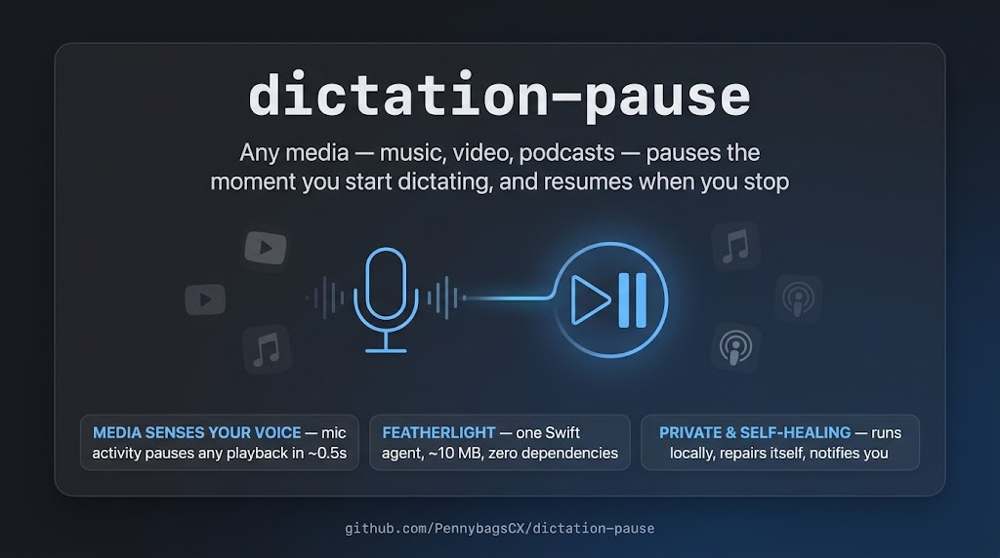

# dictation-pause



Pauses media playback while you're dictating on macOS, and resumes it when
you stop (Whisperflow-style). Scope: microphone activity — video calls also
pause playback (see "Known limitations").

## How it works

A single compiled Swift binary (~10–15 MB RSS) runs as a LaunchAgent:

1. Polls the **system mic indicator** — the "StatusIndicator" windows the
   Window Server raises for microphone activity — via CGWindowList at 4 Hz
   (~0.1–0.3% CPU). Verified to track macOS dictation sessions with clean
   start/end edges (see `diagnostics/`).
   Note: watching audio *devices* does NOT work for dictation — macOS
   captures dictation audio through a path that never sets the input
   device's IsRunningSomewhere flag.
2. **Fast path**: if the output device was rendering audio across the two
   most recent polls (≈0.5 s) before mic activity started, pause immediately.
3. **Fallback**: two output samples 0.4 s apart (skips the dictation start
   beep) so a merely *paused* tab is never toggled back ON.
4. Pause/resume is the NX_KEYTYPE_PLAY media event — byte-identical to the
   F8 key. One app (the current "now playing" session) obeys it; if Spotify
   and YouTube play simultaneously, only one pauses (macOS routes media keys
   to a single session — same for Whisperflow and the physical F8 key).

## Install

```bash
git clone https://github.com/PennybagsCX/dictation-pause && cd dictation-pause
./install.sh
```

If the log shows `WARNING: Accessibility not granted`, grant it once:
**System Settings → Privacy & Security → Accessibility → +**, press
`Cmd+Shift+G`, choose `<repo>/bin/dictation-pause`. Takes effect immediately.

**After rebuilding** (`install.sh`/`build.sh`): the ad-hoc code signature
changes, so macOS requires re-granting Accessibility — remove the old entry
and re-add. (Only needed on rebuilds, not reboots.)

## Self-healing (doctor)

`install.sh` also registers a second LaunchAgent
(`com.dts.dictation-pause-doctor`) that runs `doctor.sh` at login and every
12 hours. It auto-repairs what's safe — rebuilds a missing binary,
re-bootstraps a dropped agent — and posts a **macOS notification** when
something needs a human (Accessibility grant reset by an update, or no
detection activity in 21+ days, which usually means a macOS update changed
the dictation signal). The notification points at this README and the GitHub
repo, so nothing has to be remembered.

Run a manual check any time: `~/dev/dictation-pause/doctor.sh`

## Manage

```bash
tail -f /tmp/dictation-pause.log                                  # live log
launchctl print gui/$(id -u)/com.dts.dictation-pause              # status
launchctl bootout gui/$(id -u)/com.dts.dictation-pause            # stop/disable
launchctl bootstrap gui/$(id -u) ~/Library/LaunchAgents/com.dts.dictation-pause.plist  # start
```

## Troubleshooting

- **A specific app doesn't pause**: press the physical F8 key while that app
  plays. The agent posts the identical event — if F8 doesn't pause it, no
  media-key approach will (some Chromium builds have quirky media sessions).
- **Dictated words sometimes appear twice**: known native macOS dictation
  regression (widely reported since Sonoma, no official fix). Not caused by
  this tool — workarounds: toggle Dictation off/on, check mic permissions,
  check for Voice Control conflicts, restart.
- **Nothing happens at all**: `tail /tmp/dictation-pause.log` — every
  decision (indicator edges, output sampling, pause/resume) is logged.

## Known limitations

- Mic-scoped, not strictly dictation-scoped: any microphone activity
  (calls, voice memos) pauses playback. Detecting *dictation specifically*
  proved unreliable (the speech-daemon process churn is uncorrelated; the
  mic indicator is the only public signal).
- If you pause a video and dictate within ~30 seconds, the video may resume:
  Chromium keeps the paused tab's audio stream open briefly, and at the
  device level "paused but stream open" is indistinguishable from playing.
  The device flag goes idle once the stream closes, which is what the
  stable-playback check requires.
- Media-key events pause one app at a time (macOS media-session routing).

## Files

- `main.swift` — all logic
- `diagnostics/` — probe tools used to reverse-engineer the dictation
  signal on this OS (audio-device, process, window, correlation probes);
  useful again if Apple changes things
- `build.sh` — build (swiftc, no dependencies)
- `install.sh` — build + LaunchAgent install/start
- `/tmp/dictation-pause.log` — diagnostic log (auto-truncates at 100 KB)
